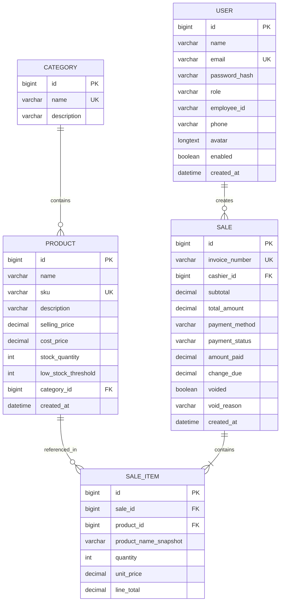

# OmniCart — Complete Technical Documentation & System Analysis

> **Document Type:** Comprehensive Technical Specification, System Analysis & Academic Viva Guide  
> **Project Name:** OmniCart  
> **Full Title:** OmniCart — Modern Retail Inventory, Point of Sale (POS) & Analytics Management System  
> **Source Code Version:** 1.0.0  
> **Analysis Methodology:** 100% Static Code Inspection of Frontend and Backend Implementations  
> **Target Audience:** Technical Evaluators, Project Guides, External Viva Examiners, Software Engineers  

---

## Table of Contents
1. [Execution Context & Analysis Methodology](#1-execution-context--analysis-methodology)
2. [Project Overview & Core Value Proposition](#2-project-overview--core-value-proposition)
3. [Complete Feature Extraction & Functional Breakdown](#3-complete-feature-extraction--functional-breakdown)
   - 3.1. [Authentication & User Management](#31-authentication--user-management)
   - 3.2. [Product & Catalog Management](#32-product--catalog-management)
   - 3.3. [Inventory Tracking & Stock Management](#33-inventory-tracking--stock-management)
   - 3.4. [Billing, Cart & Point of Sale (POS) Engine](#34-billing-cart--point-of-sale-pos-engine)
   - 3.5. [Sales History, Invoicing & Voiding Management](#35-sales-history-invoicing--voiding-management)
   - 3.6. [Role-Specific Dashboards (Owner & Cashier)](#36-role-specific-dashboards-owner--cashier)
   - 3.7. [Sales Analytics Dashboard & Dynamic Insights](#37-sales-analytics-dashboard--dynamic-insights)
   - 3.8. [OmniCart AI Assistant / Rule-Based Chatbot](#38-omnicart-ai-assistant--rule-based-chatbot)
   - 3.9. [Cross-Cutting Utilities, Seeding & UI Subsystem](#39-cross-cutting-utilities-seeding--ui-subsystem)
4. [User Roles, Authorization & Security Matrix](#4-user-roles-authorization--security-matrix)
5. [Complete Technology Stack & Dependencies](#5-complete-technology-stack--dependencies)
6. [System Architecture & Data Flow](#6-system-architecture--data-flow)
7. [Database Design, Entity Models & Relational Schema](#7-database-design-entity-models--relational-schema)
8. [Complete REST API Documentation](#8-complete-rest-api-documentation)
9. [Key Business Logic, Algorithms & Transaction Workflows](#9-key-business-logic-algorithms--transaction-workflows)
10. [Security Implementations, Validations & Integrity Controls](#10-security-implementations-validations--integrity-controls)
11. [Project Limitations & Future Enhancement Scope](#11-project-limitations--future-enhancement-scope)
12. [Complete Project Directory Structure](#12-complete-project-directory-structure)
13. [Verified Features vs. Unverified Features Matrix](#13-verified-features-vs-unverified-features-matrix)
14. [Overall Project Summary & Conclusion](#14-overall-project-summary--conclusion)

---

## 1. Execution Context & Analysis Methodology

This document was authored through exhaustive, direct static code analysis of the entire existing OmniCart codebase. Every statement, class name, endpoint URL, database column, SQL query, state hook, and business rule described in this document has been verified by inspecting the actual source code files in the repository.

### Ground Truth Verification Principles
- **No Reliance on Outdated Documentation:** While historical README documents in academic software packages often describe early prototypes or incomplete drafts, this analysis takes the *active source code* as the single version of truth. Features newly added (such as Cashier Account Management, Multi-Select Category Filters, Sales Analytics with SVG cubic bezier trend charts, interactive Multi-Mode Payment Modals, and the rule-based AI Assistant) have been fully traced from controllers to services, repositories, database mappings, and frontend components.
- **Zero Runtime Assumptions:** All descriptions are derived from source code syntax, annotations (`@Transactional`, `@EntityGraph`, `@Modifying`, `@PrePersist`), validation constraints (`@Valid`, `@PositiveOrZero`), and frontend handlers without running live application servers or modifying MySQL state.
- **Strict Implementation Fidelity:** Features that are implemented as simulated demo flows (such as UPI QR generation, card payment simulation, and rule-based regex intent detection) are explicitly documented as such, avoiding mischaracterization.

---

## 2. Project Overview & Core Value Proposition

### 2.1 Project Identity & Nomenclature
- **Project Name:** OmniCart
- **Full Project Title:** OmniCart — Modern Retail Inventory, Point of Sale (POS) & Analytics Management System
- **Academic Context:** Semester 5 Industry Practice (IP) Capstone Project

### 2.2 What OmniCart Is
OmniCart is a full-stack, enterprise-grade desktop-responsive retail management web application engineered to modernize the daily operational counter workflows of standalone and small-to-medium retail outlets (e.g., convenience stores, grocery shops, stationery outlets, and personal care boutiques). The system centralizes cataloging, real-time stock monitoring, high-speed point-of-sale checkout, customer invoice generation, sales auditing, staff performance tracking, deep financial analytics, and interactive store query assistance into a unified, secure portal.

### 2.3 The Problems OmniCart Solves
Small retail business owners historically encounter serious administrative bottlenecks:
1. **Overselling & Stock Discrepancies:** Paper ledgers and disconnected spreadsheets fail to synchronize stock levels when items are sold across concurrent checkout counters. OmniCart eliminates overselling using database-level atomic conditional decrement operations.
2. **Pricing Inaccuracies & Tampering:** Client-side cart tools that allow cashiers to transmit prices are vulnerable to tampering. OmniCart strictly enforces server-authoritative pricing: the browser transmits only product IDs and requested quantities; the backend retrieves verified prices directly from MySQL.
3. **Historical Audit Distortion:** In simple billing systems, updating a product's price or editing its name in the catalog accidentally alters all previously generated bills. OmniCart addresses this through immutable `productNameSnapshot` and frozen `unitPrice` fields stored on every individual line item.
4. **Lack of Granular Financial Visibility:** Small store owners rarely possess accessible visual analytics illustrating which payment modes dominate, which product categories yield maximum revenue, or how individual cashiers perform. OmniCart provides an interactive, zero-dependency SVG analytics dashboard calculating actual margins, growth rates, and cashier metrics.
5. **Slow Operational Lookups:** Cashiers frequently halt counter queues to confirm stock availability or search for product prices. OmniCart features an integrated, natural-language AI Assistant chatbot connected directly to database queries, enabling immediate answers to inventory and sales inquiries.

### 2.4 Target Users & Stakeholders
1. **Store Owner (Role: `ADMIN` / Display: "Owner"):** Holds overarching governance over the retail store. The Owner manages product master catalogs, creates and edits product categories, adjusts physical stock levels, views comprehensive business dashboards and financial analytics, monitors and edits cashier accounts, and exercises exclusive authority to void incorrect invoices.
2. **Cashier / Floor Staff (Role: `STAFF` / Display: "Cashier"):** Operates checkout counters. Cashiers search products, build customer carts, calculate change for cash transactions or process simulated UPI/Card payments, generate bills, print physical customer receipts, inspect inventory availability in read-only mode, and review their own shift sales performance.

### 2.5 Overall Working Concept
The operational life cycle of OmniCart follows a clear sequence:
1. **Catalog Setup:** The Owner sets up merchandise categories (e.g., Groceries, Packaged Food, Stationery) and registers products with unique Stock Keeping Units (SKUs), selling prices, cost prices, stock counts, and reorder thresholds.
2. **Counter Operation:** A Cashier logs into the POS system using secure credentials or quick demo access. At the counter, customer purchases are searched via debounced queries or added directly to the cart.
3. **Transaction Execution:** The cashier opens the Payment Modal, selects the customer's desired payment mode (Cash, UPI, or Card), inputs received tender if paying in cash, and verifies the transaction.
4. **Atomic Server Processing:** Upon checkout submission, Spring Boot executes an atomic, single-transaction database commit: validating current quantities, atomically decrementing inventory (`stock_quantity = stock_quantity - qty WHERE stock_quantity >= qty`), inserting the `Sale` record, binding individual `SaleItem` records with historical snapshots, and generating an official invoice number (`INV-YYYYMMDD-XXXXX`).
5. **Instant Synchronization:** The UI redirects to a printable invoice layout (`window.print()`), while the Owner's dashboard, low-stock alerts, and sales analytics graphs immediately reflect the updated financials.

---

## 3. Complete Feature Extraction & Functional Breakdown

### 3.1 Authentication & User Management

#### Feature: User Registration
- **Purpose:** Enables new counter cashiers to create system access credentials.
- **Access Level:** Public (unauthenticated visitors).
- **Frontend Implementation:** `frontend/src/pages/RegisterPage.jsx` provides a dedicated registration form utilizing controlled inputs for Full Name, Email, Password, and Confirm Password with real-time regex feedback.
- **Backend Implementation:** Handled by `com.omnicart.controller.AuthController.register()` calling `com.omnicart.service.AuthService.register()`.
- **API Endpoint:** `POST /api/auth/register`
- **Database Entities:** `User` (`users` table).
- **Working Process:**
  1. The user enters name, email, password, and password confirmation.
  2. The frontend verifies email structure, confirm-password equality, and regex complexity (`^(?=.*[A-Za-z])(?=.*\\d).{8,}$`).
  3. The request is submitted as a `RegisterRequest` DTO.
  4. `AuthService` converts the email to lowercase, verifies no existing account shares the email (`existsByEmailIgnoreCase`), hashes the password using `BCryptPasswordEncoder`, and **strictly forces the role to `Role.STAFF`** (preventing privilege escalation).
  5. The entity is persisted, a signed JWT token is minted via `JwtService`, and an `AuthResponse` containing the token and user payload is returned.
- **Validation & Business Rules:**
  - Public registration can *never* assign the `ADMIN` role.
  - Passwords must be at least 8 characters long and contain at least one letter and one number.
  - Emails must be unique across the entire database.
- **Expected Output:** HTTP 201 Created returning `{ token: "...", user: { id, name, email, role: "STAFF", displayRole: "Cashier", enabled: true } }` and client-side transition to `/staff/dashboard`.

#### Feature: User Authentication (Login) & Demo Sign-In
- **Purpose:** Authenticates Owners and Cashiers, returning cryptographically signed JWT bearer tokens for session establishment.
- **Access Level:** Public.
- **Frontend Implementation:** `frontend/src/pages/LoginPage.jsx` provides credential input fields with password visibility toggle, alongside one-click demonstration login triggers ("Login as Owner", "Omkar", "Ansh").
- **Backend Implementation:** Handled by `AuthController.login()` calling `AuthService.login()`.
- **API Endpoint:** `POST /api/auth/login`
- **Database Entities:** `User` table.
- **Working Process:**
  1. User submits email and plaintext password or clicks a demo login button.
  2. The backend looks up the user via `userRepository.findByEmailIgnoreCase(email)`.
  3. Checks that the account is active (`user.isEnabled() == true`). Disabled accounts are rejected immediately.
  4. Validates credentials via `passwordEncoder.matches(rawPassword, user.getPasswordHash())`.
  5. If valid, `JwtService.generateToken()` constructs an HMAC-SHA256 signed token containing the user email as subject and role as claim.
  6. The frontend stores `omnicart_token` and `omnicart_user` in `localStorage`, updates React's `AuthContext`, and navigates to the role-specific landing page (`/admin/dashboard` or `/staff/dashboard`).
- **Validation & Business Rules:** Invalid credentials or disabled user status return HTTP 401 Unauthorized with message `"Invalid email or password"`.
- **Expected Output:** Token returned and user redirected to appropriate dashboard.

#### Feature: Session Hydration & Current User Retrieval
- **Purpose:** Restores user session on browser reload or navigation and validates token freshness.
- **Access Level:** Any authenticated user.
- **Frontend Implementation:** `frontend/src/context/AuthContext.jsx` initiates a background check during startup; `api.js` Axios request interceptor attaches the bearer token.
- **Backend Implementation:** `AuthController.me()` extracting credentials via Spring Security's `Authentication` principal.
- **API Endpoint:** `GET /api/auth/me`
- **Expected Output:** Current user details (`id`, `name`, `email`, `role`, `displayRole`, `employeeId`, `phone`, `avatar`, `enabled`).

#### Feature: Profile Management & Avatar Upload
- **Purpose:** Allows logged-in users to manage personal details, phone numbers, and profile photos.
- **Access Level:** Authenticated Owner and Cashiers.
- **Frontend Implementation:** `frontend/src/pages/ProfilePage.jsx` renders an interactive profile interface featuring HTML5 FileReader image upload to base64 DataURL, real-time preview, and editable contact fields.
- **Backend Implementation:** Handled by `com.omnicart.controller.ProfileController.updateProfile()`.
- **API Endpoint:** `GET /api/profile`, `PUT /api/profile`
- **Database Entities:** `User` (`avatar` column defined as `LONGTEXT` / `@Lob`).
- **Working Process:**
  1. The user selects a local image file (PNG/JPG/WEBP).
  2. The client confirms the file is an image and under 2MB, reading it into a base64 string.
  3. Submits `ProfileUpdateRequest(name, phone, avatar)`.
  4. The backend verifies avatar payload length `<= 3,500,000` characters, updates the user record, and persists it.
  5. Immutable fields (`email`, `role`, `employeeId`, `passwordHash`) are shielded from modification.
- **Expected Output:** HTTP 200 with updated user response and live UI avatar refresh.

#### Feature: Cashier Account Governance (Admin Only)
- **Purpose:** Provides the Shop Owner complete oversight over cashier staffing, contact details, account status, and transaction histories.
- **Access Level:** Owner (`ADMIN`) only.
- **Frontend Implementation:** `frontend/src/pages/CashierManagementPage.jsx` provides a full management table with status badges, edit modals, deactivation modals, and direct links to view sales created by specific cashiers.
- **Backend Implementation:** `com.omnicart.controller.CashierController`.
- **API Endpoints:**
  - `GET /api/cashiers`: Lists all staff accounts ordered by name.
  - `GET /api/cashiers/{id}`: Detailed cashier profile.
  - `PUT /api/cashiers/{id}`: Edits cashier full name and phone number.
  - `PATCH /api/cashiers/{id}/toggle-status`: Activates or deactivates cashier login access.
  - `DELETE /api/cashiers/{id}`: Dual-action delete/deactivate routine.
  - `GET /api/cashiers/{id}/sales`: Returns all historical sales generated by that cashier.
- **Database Entities:** `User`, `Sale`.
- **Crucial Business Rules (Foreign Key Protection & Audit Preservation):**
  - If a cashier has **0** recorded sales, `DELETE /api/cashiers/{id}` performs a permanent hard delete from the database (`userRepository.delete()`).
  - If a cashier has **1 or more** recorded sales, hard deletion would cause a foreign key violation or destroy audit trails. The system automatically switches to **safe deactivation** (`enabled = false`), preserving invoice histories and returning a clear notification: `"Cashier account [Name] has X historical sales. Account was safely deactivated to preserve sales history and invoices."`

---

### 3.2 Product & Catalog Management

#### Feature: Category Management
- **Purpose:** Groups inventory items into logical merchandise departments (e.g., Groceries, Stationery, Household).
- **Access Level:** Read access for all authenticated users; Create, Update, Delete for Owner only.
- **Frontend Implementation:** `frontend/src/pages/CategoriesPage.jsx` renders category cards, modal forms, and deletion confirmation dialogs.
- **Backend Implementation:** `com.omnicart.controller.CategoryController` and `com.omnicart.service.CategoryService`.
- **API Endpoints:**
  - `GET /api/categories`: Returns all categories with live `productCount`.
  - `POST /api/categories`: Creates a new category.
  - `PUT /api/categories/{id}`: Renames or updates description.
  - `DELETE /api/categories/{id}`: Deletes a category.
- **Database Entities:** `Category` (`categories` table).
- **Business Rules:**
  - Category names must be unique (`categoryRepository.existsByNameIgnoreCase`). Duplicate entries throw HTTP 409 Conflict.
  - A category containing products **cannot be deleted**. The service calls `productRepository.existsByCategoryId(id)` and aborts with HTTP 409: `"Cannot delete '[Name]' because it still has products. Move them to another category first."`

#### Feature: Product Master Catalog Management
- **Purpose:** Complete CRUD lifecycle management for all store merchandise.
- **Access Level:** Read access for Cashier & Owner; Create, Edit, Delete for Owner only.
- **Frontend Implementation:** `frontend/src/pages/ProductsPage.jsx` featuring multi-category filtering, debounced search, responsive data tables, stock status badges, and paginated navigation.
- **Backend Implementation:** `com.omnicart.controller.ProductController` and `com.omnicart.service.ProductService`.
- **API Endpoints:**
  - `GET /api/products?search=&categoryIds=&page=&size=`: Searches catalog.
  - `GET /api/products/{id}`: Product details.
  - `POST /api/products`: Creates new product.
  - `PUT /api/products/{id}`: Updates product attributes.
  - `DELETE /api/products/{id}`: Deletes product (with historical sales protection).
- **Database Entities:** `Product`, `Category`, `SaleItem`.
- **Attributes Managed:** Product Name, SKU (Stock Keeping Unit), Category, Selling Price, Cost Price, Stock Quantity, Low-Stock Alert Threshold, Description.
- **Business Rules:**
  - **SKU Uniqueness:** Every SKU is converted to uppercase and trimmed. Uniqueness is strictly checked across the database (`existsBySkuIgnoreCase` / `existsBySkuIgnoreCaseAndIdNot`).
  - **Positive Financials:** Selling price must be strictly positive (`@Positive`), cost price cannot be negative (`@PositiveOrZero`).
  - **Integrity Protection on Delete:** Products that have appeared in prior sales cannot be deleted because historical receipts reference them. `ProductService.delete()` queries `saleItemRepository.existsByProductId(id)`. If true, deletion is blocked with HTTP 409 Conflict: `"'[Product Name]' appears in past sales and cannot be deleted. Set its stock to 0 instead."`

#### Feature: Multi-Select Category Filtering
- **Purpose:** Allows cashiers and owners to filter product lists across multiple categories simultaneously (e.g., selecting both "Groceries" and "Household").
- **Frontend Implementation:** `frontend/src/components/MultiSelectCategoryFilter.jsx` provides an accessible custom dropdown with checkboxes, "All categories" toggle, indeterminate checkbox state, and badge counters.
- **Backend Implementation:** `ProductRepository.searchWithCategories()` executes dynamic JPQL:
  ```sql
  SELECT p FROM Product p WHERE (LOWER(p.name) LIKE LOWER(CONCAT('%', :q, '%')) 
  OR LOWER(p.sku) LIKE LOWER(CONCAT('%', :q, '%'))) 
  AND p.category.id IN :categoryIds
  ```

---

### 3.3 Inventory Tracking & Stock Management

#### Feature: Real-Time Stock Monitoring & Status Categorization
- **Purpose:** Gives instant visual indicators of current merchandise shelf and warehouse quantities.
- **Access Level:** Available to all logged-in staff; adjustments restricted to Owner.
- **Frontend Implementation:** `frontend/src/pages/InventoryPage.jsx`.
- **Backend Implementation:** `com.omnicart.controller.InventoryController` calling `ProductService`.
- **API Endpoints:**
  - `GET /api/inventory`: Paginated product inventory list.
  - `GET /api/inventory/low-stock`: Returns products at or below threshold.
  - `PATCH /api/inventory/{id}/stock`: Updates physical stock quantity (Owner only).
- **Computed Stock Statuses (handled via `Mapper.toProduct()`):**
  - `OUT_OF_STOCK`: When `stockQuantity <= 0` (rendered as red badge).
  - `LOW_STOCK`: When `stockQuantity <= lowStockThreshold` (rendered as amber badge).
  - `IN_STOCK`: When `stockQuantity > lowStockThreshold` (rendered as green badge).

#### Feature: Owner Stock Adjustment
- **Purpose:** Allows the owner to adjust stock counts following warehouse arrivals, damages, or manual inventory counts.
- **Process:** The Owner clicks the adjustment icon (`PackagePlus`) on `InventoryPage`, enters the new integer quantity, and submits a `PATCH /api/inventory/{id}/stock` request with `StockUpdateRequest(stockQuantity)`.

---

### 3.4 Billing, Cart & Point of Sale (POS) Engine

The POS subsystem is the primary operational module in OmniCart. It guarantees transactional consistency, prevents client-side price manipulation, and handles checkout workflows.

#### Step-by-Step Billing Workflow:
1. **Product Discovery & Selection:**
   - The cashier opens `/billing`.
   - The cashier types into the search bar. The input is debounced using `useDebounce(query)` (300ms) to prevent unnecessary backend requests.
   - Products matching the query are displayed with their live stock and selling prices.
2. **Cart Assembly & Client Validation:**
   - Clicking "Add" or pressing the plus icon inserts the product into React state (`cart: [{ product, quantity }]`).
   - The UI inspects available stock: if a cashier tries to add more units than currently exist (`current + 1 > product.stockQuantity`), the client blocks the action and triggers a toast notification: `"Only X of [Product] in stock"`.
3. **Cart Management:**
   - Cashiers adjust quantities using `+` and `-` controls or delete items via the trash icon.
   - Subtotal and total item count are computed in real time for display.
4. **Payment Initiation:**
   - Clicking "Proceed to Payment" opens `frontend/src/components/PaymentModal.jsx`.
   - The modal isolates payment selection from sale creation: **no sale is recorded in the database until the payment is explicitly completed and confirmed.**

```
[Cashier selects products] ──> [Debounced Search] ──> [Add to Cart]
                                                             │
[Sale Created in DB] <── [Verify & Settle] <── [Payment Modal: Cash/UPI/Card]
        │
        ├── Atomic Stock Decrement (`deductStock`)
        ├── Sale & SaleItem Snapshot Insertion
        └── Printable Invoice Generation (`/sales/{id}`)
```

#### Multi-Mode Payment Processing Subsystem:
- **Mode 1: CASH Payment Handling**
  - Displays Total Payable, Cash Received input, and Change Due.
  - Includes quick-tender shortcut buttons (`+₹50`, `+₹100`, `+₹200`, `+₹500`) and an "Exact Cash" button.
  - Real-time client calculation: `changeDue = Math.max(0, numCashReceived - total)`.
  - Enforces that cash received cannot be less than total payable.
- **Mode 2: Simulated UPI / QR Code Payment**
  - Generates an in-browser SVG QR code encoding store payment details.
  - Displays store UPI ID (`omnicart.retail@upi`) and a "Simulate Customer Payment" trigger.
  - Generates a simulated reference code (e.g., `UPI-849201`) with green approval checkmark before permitting sale confirmation.
- **Mode 3: Simulated Card Payment**
  - Renders an interactive credit/debit card graphic with dynamic cardholder name, masked card number formatting (`4532 •••• •••• 4242`), expiry date, and CVV.
  - Includes a "Fill Demo Card" helper button for fast viva demonstrations.
  - Simulates payment gateway authorization (`AUTH-XXXX`).

#### Backend Transactional Execution (`BillingService.createSale`):
When the cashier confirms payment, the client dispatches `POST /api/sales` with:
```json
{
  "items": [{ "productId": 1, "quantity": 2 }, { "productId": 3, "quantity": 1 }],
  "paymentMethod": "CASH",
  "amountPaid": 1500.00
}
```
1. **Server-Authoritative Pricing:** The frontend sends *only* `productId` and `quantity`. Prices transmitted by browsers are disregarded; all calculations use prices fetched directly from MySQL.
2. **Duplicate Merging via Stable Map:** If duplicate items exist in the payload, they are merged using `TreeMap<Long, Integer> wanted`. The natural ordering of product IDs helps prevent database deadlocks during concurrent stock updates.
3. **Atomic Stock Decrement:** For every item in the cart, the service executes:
   ```java
   int rowsUpdated = productRepository.deductStock(product.getId(), qty);
   if (rowsUpdated == 0) {
       throw new ApiException(HttpStatus.CONFLICT, "Not enough stock for " + product.getName());
   }
   ```
   Because this query runs conditionally (`WHERE p.id = :id AND p.stockQuantity >= :qty`), if two cashiers attempt to sell the final unit simultaneously, exactly one transaction will succeed and the other will abort with an HTTP 409 Conflict exception.
4. **Transactional Rollback:** The entire method is annotated with `@Transactional`. If any product runs out of stock halfway through the cart, the transaction rolls back, undoing all previous deductions in that request.
5. **Snapshot Persistence:** For each item, a `SaleItem` record is created storing `productNameSnapshot = product.getName()` and `unitPrice = product.getSellingPrice()`. Future catalog edits will never alter this invoice.
6. **Payment Finalization:** Validates payment rules (e.g., `amountPaid >= subtotal` for cash). Computes `changeDue`. Sets `PaymentStatus.PAID`.
7. **Invoice Assignment:** Generates invoice number with format `INV-YYYYMMDD-ID05d` (e.g., `INV-20261103-00042`).
8. **Client Response:** Returns the complete `SaleResponse` DTO, and the frontend transitions to `/sales/{id}` with a confirmation banner.

---

### 3.5 Sales History, Invoicing & Voiding Management

#### Feature: Sales Listing & Multi-Param Filtering
- **Purpose:** Centralized repository of all transactions generated across the store.
- **Access Level:** Role-aware:
  - **Owner (`ADMIN`):** Sees all sales across all counters; can filter by specific Cashier, date range (`from` / `to`), and invoice number.
  - **Cashier (`STAFF`):** Automatically constrained to view *only their own created sales*.
- **Backend Implementation:** `SaleRepository.search()`:
  ```sql
  SELECT s FROM Sale s WHERE UPPER(s.invoiceNumber) LIKE UPPER(CONCAT('%', :inv, '%'))
  AND s.createdAt >= :from AND s.createdAt < :to
  AND (:cashierId IS NULL OR s.cashier.id = :cashierId)
  AND s.voided = false
  ```
  `BillingService.search()` checks the caller's role: if `STAFF`, it overrides `effectiveCashierId = viewer.getId()`.

#### Feature: Printable Customer Invoices
- **Purpose:** Renders an official receipt suitable for physical thermal/A4 printing or digital saving.
- **Frontend Implementation:** `frontend/src/pages/InvoicePage.jsx`.
- **Key Elements Displayed:** Store Branding ("OmniCart"), Invoice Number, Timestamp, Cashier Name, Line Items table (Product, Quantity, Unit Price, Line Total), Grand Total, Payment Mode Badge, Cash Received & Change Returned (for cash sales), or Demo Settlement Notice (for UPI/Card).
- **Printing Integration:** Clicking "Print Invoice" invokes browser `window.print()`. Clean CSS media queries (`@media print`) hide navigation bars, sidebar, and action buttons, leaving only the receipt.

#### Feature: Sale Voiding / Soft Deletion (Owner Only)
- **Purpose:** Allows the store owner to cancel or delete an erroneous bill while preserving historical inventory consistency.
- **Access Level:** Owner only.
- **Backend Implementation:** `BillingService.deleteSale()`.
- **Working Mechanism:** The system flags `sale.setVoided(true)` and records `voidReason = "Deleted by Owner " + viewer.getName()`. All analytics queries, sales history lookups, and cashier totals filter by `voided = false`. The invoice remains viewable by ID with a red warning banner: `"*** VOIDED INVOICE — CANCELLED BY SHOP OWNER ***"`.

---

### 3.6 Role-Specific Dashboards (Owner & Cashier)

#### Feature: Owner Executive Dashboard
- **Access Level:** Owner only (`/admin/dashboard`).
- **Endpoint:** `GET /api/dashboard/summary`, `GET /api/dashboard/low-stock`, `GET /api/dashboard/recent-sales`.
- **Implemented Widgets & KPIs:**
  1. **Total Products:** Total count of active items in catalog (`productRepository.count()`).
  2. **Total Categories:** Total departments (`categoryRepository.count()`).
  3. **Total Sales:** Count of active, non-voided sales (`saleRepository.countActive()`).
  4. **Total Revenue:** Sum of all active order totals (`saleRepository.totalRevenue()`).
  5. **Low Stock Alert Table:** Lists products where stock is at or below threshold with current quantity and threshold values.
  6. **Recent Sales Table:** Shows the latest 5 transactions across the shop with cashier names and amounts.

#### Feature: Cashier Shift Dashboard
- **Access Level:** Cashier (`/staff/dashboard`).
- **Endpoint:** `GET /api/dashboard/staff-summary`, `GET /api/dashboard/recent-sales`.
- **Implemented Widgets & KPIs:**
  1. **Bills Today:** Number of sales created by this specific cashier since midnight (`countForCashierBetween`).
  2. **Sales Today:** Total rupee revenue generated by this cashier today (`revenueForCashierBetween`).
  3. **Personal Recent Sales:** Table of the 5 most recent sales completed by the logged-in cashier.
  4. **Quick Links:** Quick actions to "Find products" and "Create bill".

---

### 3.7 Sales Analytics Dashboard & Dynamic Insights

The Sales Analytics subsystem (`/admin/analytics`) provides the store owner with interactive financial intelligence without relying on third-party charting libraries.

```
┌───────────────────────────────────────────────────────────────────────────┐
│                           SALES ANALYTICS                                 │
├─────────────────┬─────────────────┬─────────────────┬─────────────────────┤
│  Total Revenue  │  Total Orders   │ Avg Order Value │  Total Items Sold   │
│   ₹42,850.00    │       84        │     ₹510.12     │         214         │
│  (+14.2% vs prev│  (+8.1% vs prev)│                 │                     │
├─────────────────┴─────────────────┴─────────────────┴─────────────────────┤
│  REVENUE & ORDER TRENDS (Custom SVG Cubic Bezier Curve Area Chart)        │
│  [Toggle: Revenue / Orders]  •  Interactive Data Points  •  Day Tooltips  │
├───────────────────────────────────┬───────────────────────────────────────┤
│  PAYMENT METHODS BREAKDOWN        │  CATEGORY SALES BREAKDOWN             │
│  Cash: 48.2% | UPI: 35.1% | Card  │  Groceries: 52% | Packaged Food: 24%  │
├───────────────────────────────────┴───────────────────────────────────────┤
│  TOP PRODUCTS (By Quantity & By Revenue)  •  CASHIER PERFORMANCE TABLE    │
└───────────────────────────────────────────────────────────────────────────┘
```

#### Detailed Breakdown of Implemented Analytics Features:

1. **Top-Level KPI Cards:**
   - **Total Revenue:** Aggregated total across selected date range.
   - **Total Orders:** Count of unique invoices in the period.
   - **Average Order Value (AOV):** Calculated as `totalRevenue / totalOrders` (using `RoundingMode.HALF_UP`).
   - **Total Items Sold:** Sum of all item quantities across all orders in range.
   - **Today's Revenue & Orders:** Live counters comparing today's performance.
   - **Period Growth Comparisons:** Compares current period metrics against the immediately preceding period of identical length (e.g., this week vs. last week). Displays positive/negative percentage badges (`revenueGrowthPct`, `ordersGrowthPct`).

2. **Custom SVG Revenue & Order Trend Chart (`RevenueTrendChart.jsx`):**
   - **No External Dependencies:** Built with pure React and SVG.
   - **Smooth Curve Algorithm:** Employs a monotonic cubic bezier curve generator:
     ```javascript
     cpX1 = curr.x + (next.x - curr.x) / 3;
     cpX2 = curr.x + (2 * (next.x - curr.x)) / 3;
     d += ` C ${cpX1} ${curr.y}, ${cpX2} ${next.y}, ${next.x} ${next.y}`;
     ```
   - **Dual Metric Views:** Toggle button switches between daily revenue view (rupees) and daily order count view.
   - **Zero-Sales Handling:** Accurately plots zero-sale days so retail revenue gaps are visible.
   - **Interactive Hover:** Displays precise date, day label, revenue, order count, and item count.

3. **Date Range Filters:**
   - Preset buttons: **Today**, **Last 7 Days**, **Last 30 Days**, **This Month**, **This Year**.
   - **Custom Range:** Date pickers allowing start and end date specification.

4. **Payment Mode Breakdown:**
   - Summarizes share of Cash, UPI, and Card transactions.
   - Displays count, revenue, and percentage of total revenue.

5. **Category-Wise Breakdown:**
   - Groups sales by merchandise category (`Groceries`, `Stationery`, etc.).
   - Displays units sold, revenue, and percentage contribution.

6. **Top-Selling Products (Dual Rankings):**
   - **By Quantity Sold:** Ranks products that moved the highest unit volumes.
   - **By Revenue Generated:** Ranks products that contributed the most revenue.

7. **Cashier Performance Analytics:**
   - Tracks each cashier's performance: Cashier Name, Employee ID, Total Bills Generated, Total Revenue Contributed, Total Items Sold, and Average Bill Value (AOV).
   - Automatically highlights the top-performing cashier with an award badge.

8. **Dynamic Business Insights:**
   - Automatically computes human-readable summaries:
     - *"Highest revenue day: 28 Oct with ₹6,450.00 across 12 bills."*
     - *"Top payment method: UPI accounting for 54.2% of total revenue."*
     - *"Top category: Groceries contributing ₹14,200.00 (48.5% of revenue)."*

---

### 3.8 AI Chatbot / OmniCart Assistant

OmniCart includes an integrated store assistant designed for quick lookups and cashier assistance.

```
┌────────────────────────────────────────────────────────┐
│  AI Chatbot  [Owner/Cashier Badge]         [—] [X]     │
├────────────────────────────────────────────────────────┤
│  🤖 Hello Harsh Patel! I'm your OmniCart AI Assistant, │
│     connected directly to your MySQL database.         │
│                                                        │
│  👤 What are today's total sales?                      │
│                                                        │
│  🤖 Today's total store sales are ₹3,450.00 across     │
│     6 bills generated so far.                          │
│                                                        │
│  ✨ Suggested questions:                               │
│  [Show cashier-wise sales]  [Which products low stock] │
├────────────────────────────────────────────────────────┤
│  [Ask me anything about OmniCart...           ] [Send] │
└────────────────────────────────────────────────────────┘
```

#### Technical Classification: Rule-Based Database Assistant
The assistant is technically classified as an **intelligent rule-based Natural Language Processing (NLP) database assistant**. It does not call external third-party Large Language Model APIs (such as OpenAI or Google Gemini). Instead, it runs **locally and deterministically** within Spring Boot. This approach guarantees zero API latency, zero external API costs, complete data privacy, and mathematically verified answers derived directly from live database tables.

#### Key Architectural Components:
1. **Frontend Floating Widget (`frontend/src/components/Chatbot.jsx`):**
   - Present across all authenticated pages inside `DashboardLayout`.
   - Floating Action Button (FAB) with pulse indicator.
   - Supports minimize, expand, clear conversation with confirmation, and message history persistence in `sessionStorage`.
   - Formatted Markdown rendering (supports `**bold**`, bullet points, and warning banners).
   - Dynamic suggested question chips below the latest response.
2. **Intent & Entity Detector (`com.omnicart.assistant.IntentDetector`):**
   - Normalizes text (lowercasing, punctuation stripping, whitespace collapsing).
   - Matches intent patterns using keyword sets and regular expressions.
   - Extracts target entities (e.g., product names from `"price of Basmati Rice"` or cashier names from `"did Omkar generate bills"`).
   - Detects and blocks SQL injection patterns (`DROP TABLE`, `UNION SELECT`, `DELETE FROM`, etc.).
3. **Intent Enumeration (`ChatIntent`):**
   Includes 28 distinct intents:
   - `GREETING`, `HELP`, `BILLING_HELP`, `INVENTORY_HELP`, `SHOP_SUMMARY`, `SALES_SUMMARY`
   - `TODAY_SALES`, `TODAY_BILLS`, `YESTERDAY_SALES`, `MONTHLY_SALES`, `RECENT_SALES`
   - `MY_SALES_TODAY`, `MY_BILLS_TODAY`, `MY_RECENT_BILLS`, `MY_MONTHLY_BILLS`
   - `CASHIER_SALES`, `CASHIER_BILLS`, `CASHIER_LEADERBOARD`, `CASHIER_TODAY_BREAKDOWN`
   - `TOTAL_PRODUCTS`, `LOW_STOCK`, `OUT_OF_STOCK`, `PRODUCT_STOCK`, `PRODUCT_PRICE`, `PRODUCT_SEARCH`, `CATEGORY_STATS`
   - `SECURITY_VIOLATION`, `UNKNOWN`
4. **Service Execution & Role Protection (`AssistantService`):**
   - Connects directly to Spring Data repositories (`SaleRepository`, `ProductRepository`, `CategoryRepository`, `UserRepository`).
   - **Strict Role-Based Privacy Guard:** When a Cashier asks store-wide financial questions (e.g., *"What are today's total sales?"*), the assistant detects the role restriction and responds:
     ```
     🔒 Role Restriction: Overall store sales are restricted to the shop owner.
     However, for your account (Omkar), your sales today are ₹750.00 across 2 bills.
     ```
   - Cashiers asking about other cashiers' figures are similarly restricted: `"🔒 Access Restricted: Cashiers can only view their own sales figures."`

---

### 3.9 Cross-Cutting Utilities, Seeding & UI Subsystem

#### Automated Data Seeder (`DataSeeder.java` & `DemoSalesSeeder.java`):
- Runs automatically on application startup when `app.seed.enabled=true`.
- **Idempotent:** Checks `existsByEmailIgnoreCase` and `existsBySkuIgnoreCase` to prevent duplicate insertions on restart.
- **Pre-Configured Accounts:**
  - Owner: `admin@omnicart.local` (Password: `Admin@123`, Name: `Harsh Patel`)
  - Cashier 1: `omkar@gmail.com` (Password: `1234`, Employee ID: `EMP-001`, Name: `Omkar`)
  - Cashier 2: `ansh@gmail.com` (Password: `1234`, Employee ID: `EMP-002`, Name: `Ansh`)
  - Legacy Cashier: `staff@omnicart.local` (Password: `Staff@123`, Employee ID: `EMP-003`, Name: `Demo Cashier`)
- **Product Catalog Seeding:** Seeds **50 distinct retail products** across 5 categories with prices, SKUs, and stock levels.
- **Historical Sales Seeding:** Seeds realistic historical transactions spread across the preceding 30 days to populate the Sales Analytics dashboard. Historical sales carry the `DEMO-INV-` prefix and do not deduct live stock.

#### Toast Notification System (`ToastContext.jsx`):
- Provides global notification banners (`toast.success()`, `toast.error()`, `toast.warn()`).
- Auto-dismisses after 4 seconds with smooth fade-in animations.

---

## 4. User Roles, Authorization & Security Matrix

OmniCart implements role-based access control (RBAC) enforced simultaneously across frontend navigation guards and backend Spring Security filters.

### 4.1 Role Comparison Matrix

| Operational Capability | Shop Owner (`ADMIN`) | Cashier Staff (`STAFF`) | Enforcement Location |
| :--- | :---: | :---: | :--- |
| Public Landing Page Access | Yes | Yes | Public |
| Login & Demo Login Access | Yes | Yes | Public |
| Self-Registration via Web Form | No (Always creates STAFF) | Yes (Creates STAFF) | `AuthService.register()` |
| Store Executive Dashboard | **Yes** | No | `SecurityConfig` (`/api/dashboard/summary`) |
| Cashier Shift Dashboard | No | **Yes** | Frontend Route & Layout Link |
| View Products Catalog | Yes | Yes | Shared API (`/api/products`) |
| Add New Products | **Yes** | No | `SecurityConfig` (`POST /api/products`) |
| Edit Existing Products | **Yes** | No | `SecurityConfig` (`PUT /api/products/**`) |
| Delete Products | **Yes** | No | `SecurityConfig` (`DELETE /api/products/**`) |
| Multi-Select Category Filter | Yes | Yes | Frontend Component & JPQL Query |
| Create / Edit / Delete Categories | **Yes** | No | `SecurityConfig` (`/api/categories/**`) |
| View Inventory Quantities | Yes | Yes | Shared API (`/api/inventory`) |
| Adjust Stock Quantities | **Yes** | No | `SecurityConfig` (`PATCH /api/inventory/**`) |
| Access POS Billing Screen | Yes | Yes | Shared API (`/billing`) |
| Process Cash / UPI / Card Payments | Yes | Yes | Shared POS Modal |
| Generate Bills & Deduct Stock | Yes | Yes | `POST /api/sales` |
| View All Store Sales History | **Yes** | No | `BillingService.search()` (Role Check) |
| View Own Created Sales History | Yes | **Yes** | Constrained to `viewer.getId()` |
| Filter Sales by Any Cashier | **Yes** | No | Dropdown rendered only for Owner |
| Print Customer Invoices | Yes | Yes | `window.print()` on `/sales/:id` |
| Void / Soft-Delete Invoices | **Yes** | No | `BillingService.deleteSale()` |
| Access Sales Analytics Dashboard | **Yes** | No | `SecurityConfig` (`/api/analytics/**`) |
| View Store Revenue & Trends | **Yes** | No | `AnalyticsController` |
| Cashier Management Portal | **Yes** | No | `SecurityConfig` (`/api/cashiers/**`) |
| Edit Cashier Name & Phone | **Yes** | No | `CashierController.updateCashier()` |
| Toggle Cashier Active Status | **Yes** | No | `CashierController.toggleStatus()` |
| Delete / Deactivate Cashier | **Yes** | No | `CashierController.deleteOrDeactivate()` |
| Access AI Chatbot | Yes | Yes | Shared Component (`Chatbot.jsx`) |
| Query Store-Wide Revenue in Chatbot | **Yes** | No (Shows Role Restriction) | `AssistantService.java` |
| Query Other Cashier Performance in Chat | **Yes** | No (Restricted) | `AssistantService.java` |
| Edit Own Profile Name, Phone & Avatar | Yes | Yes | `/api/profile` |

---

## 5. Complete Technology Stack & Dependencies

### 5.1 Backend Technology Stack
- **Language:** Java 17 (LTS)
- **Framework:** Spring Boot 3.2.5
- **Build System:** Apache Maven 3.9+
- **Security:** Spring Security 6.x with custom stateless JWT Filter (`OncePerRequestFilter`)
- **JWT Provider:** JJWT (Java JWT) version 0.12.5 (`jjwt-api`, `jjwt-impl`, `jjwt-jackson`)
- **Persistence & ORM:** Spring Data JPA with Hibernate 6.x
- **Database Driver:** MySQL Connector/J (`com.mysql:mysql-connector-j`, runtime scope)
- **Validation:** Hibernate Validator / Jakarta Bean Validation (`spring-boot-starter-validation`)
- **Productivity & Code Reduction:** Project Lombok 1.18.38 (`@Getter`, `@Setter`, `@NoArgsConstructor`, `@RequiredArgsConstructor`)
- **Unit Testing:** JUnit 5 (Jupiter), Mockito (`mockito-core`, `mockito-junit-jupiter`), Spring Boot Starter Test

### 5.2 Frontend Technology Stack
- **Core Library:** React 18.3.1
- **DOM Renderer:** React DOM 18.3.1
- **Build Tool & Dev Server:** Vite 5.3.3 with `@vitejs/plugin-react` 4.3.1
- **Client-Side Routing:** React Router DOM 6.24.0 (HTML5 History API with `BrowserRouter`, `Routes`, `Route`, `Navigate`)
- **HTTP Client:** Axios 1.7.2 (Configured with request and response interceptors for JWT injection and 401 handling)
- **Iconography:** Lucide React 0.400.0 (Feather-derived SVG icons)
- **Styling Architecture:** Custom Vanilla CSS Design System (`frontend/src/index.css`, ~48KB). Utilizes CSS Custom Properties (variables) for theme tokens, dark mode gradients, glassmorphism card surfaces, and print stylesheets. **Tailwind CSS is intentionally absent.**

### 5.3 Database & Runtime Infrastructure
- **RDBMS Engine:** MySQL 8.x
- **Schema Management:** Automated Hibernate DDL generation (`spring.jpa.hibernate.ddl-auto=update`)
- **Character Encoding:** UTF-8 Unicode

---

## 6. System Architecture & Data Flow

OmniCart utilizes a decoupled client-server architecture. The frontend Single Page Application (SPA) communicates with the backend REST API exclusively through stateless HTTP requests carrying JSON payloads and JWT authorization headers.

### 6.1 Architectural Layers

```mermaid
graph TD
    Client[React 18 SPA (Vite)] -->|HTTP + JWT Bearer| Security[Spring Security & JwtAuthFilter]
    Security --> Controller[Controller Layer (REST Endpoints)]
    Controller --> Service[Service Layer (Business Logic & Transactions)]
    Service --> Repo[Repository Layer (Spring Data JPA / JPQL)]
    Repo --> DB[(MySQL 8 Database)]
    
    subgraph "Frontend Subsystems"
        AuthCtx[AuthContext & localStorage]
        POS[POS Billing & Payment Modal]
        Analytics[Sales Analytics & SVG Chart]
        ChatUI[AI Chatbot Widget]
    end
    
    subgraph "Backend Subsystems"
        BillingEngine[BillingService - Atomic Deduction]
        AnalyticsEngine[AnalyticsService - Aggregations]
        AssistantEngine[AssistantService & IntentDetector]
    end
```

### 6.2 Request-Response Lifecycle
1. **Request Dispatch:** A user interaction triggers an Axios call in the React application.
2. **Token Injection:** The Axios request interceptor (`frontend/src/services/api.js`) retrieves `omnicart_token` from `localStorage` and appends `Authorization: Bearer <token>`.
3. **CORS & Filter Interception:** The request reaches Spring Boot. `CorsConfigurationSource` validates the frontend origin (`http://localhost:5173`). Next, `JwtAuthFilter` extracts the token, verifies the cryptographic signature with the HMAC-SHA secret key, parses the subject email, and sets `UsernamePasswordAuthenticationToken` in `SecurityContextHolder`.
4. **URL & Role Authorization:** `SecurityConfig` verifies that the route matches permitted role rules (e.g., verifying `ROLE_ADMIN` for `/api/analytics/**`). If unauthorized, it executes an entry point returning HTTP 401 or access denied handler returning HTTP 403.
5. **Controller Handling:** The request arrives at the designated `@RestController` which binds and validates request bodies via `@Valid`.
6. **Service & Transaction Boundary:** The controller delegates to the `@Service` layer. Methods annotated with `@Transactional` establish database transaction boundaries.
7. **Repository & Query Execution:** Spring Data JPA executes generated or parameterized JPQL queries against MySQL.
8. **DTO Transformation:** Entities are mapped into immutable Java record DTOs via `Mapper.java` to prevent exposing password hashes or entity internal states.
9. **Global Exception Interception:** Any uncaught `ApiException`, validation error, or data integrity violation is caught by `GlobalExceptionHandler` (`@RestControllerAdvice`) and converted into a standardized JSON error format:
   ```json
   {
     "timestamp": "2026-11-03T09:30:00.000",
     "status": 409,
     "message": "SKU 'GRO-001' is already used by another product",
     "fieldErrors": null
   }
   ```

---

## 7. Database Design, Entity Models & Relational Schema

### 7.1 Entity Relationship Diagram



### 7.2 Entity Specifications

#### Entity 1: `User` (`users` table)
- **Purpose:** Stores user credentials, assigned roles, personal contact details, and employee identifiers.
- **Fields:**
  - `id` (`BIGINT`, PK, Auto-Increment)
  - `name` (`VARCHAR(100)`, Not Null): Full name of the user.
  - `email` (`VARCHAR(150)`, Unique, Not Null): Login email address.
  - `passwordHash` (`VARCHAR(255)`, Not Null): BCrypt salted password hash.
  - `role` (`VARCHAR(20)`, Enum `Role`, Not Null): `ADMIN` (Owner) or `STAFF` (Cashier).
  - `employeeId` (`VARCHAR(30)`, Nullable): Staff identification code (e.g., `EMP-001`). Strictly `null` for Owners.
  - `phone` (`VARCHAR(20)`, Nullable): Contact phone number.
  - `avatar` (`LONGTEXT`, Nullable): Base64-encoded profile picture data URL.
  - `enabled` (`BOOLEAN`, Not Null, Default `true`): Account activation flag.
  - `createdAt` (`DATETIME`, Not Null, Updatable `false`): Timestamp of creation.

#### Entity 2: `Category` (`categories` table)
- **Purpose:** Groups inventory items into retail departments.
- **Fields:**
  - `id` (`BIGINT`, PK, Auto-Increment)
  - `name` (`VARCHAR(100)`, Unique, Not Null): Department title.
  - `description` (`VARCHAR(255)`, Nullable): Department summary.

#### Entity 3: `Product` (`products` table)
- **Purpose:** Represents individual merchandise items in the store catalog.
- **Fields:**
  - `id` (`BIGINT`, PK, Auto-Increment)
  - `name` (`VARCHAR(150)`, Not Null): Commercial product title. Indexed (`idx_product_name`).
  - `sku` (`VARCHAR(50)`, Unique, Not Null): Stock Keeping Unit code.
  - `description` (`VARCHAR(500)`, Nullable): Detailed product description.
  - `sellingPrice` (`DECIMAL(10,2)`, Not Null): Active unit retail price charged to customers.
  - `costPrice` (`DECIMAL(10,2)`, Nullable): Unit acquisition cost.
  - `stockQuantity` (`INT`, Not Null): Current shelf/warehouse units available.
  - `lowStockThreshold` (`INT`, Not Null): Reorder threshold triggering alerts.
  - `category_id` (`BIGINT`, FK, Not Null): Foreign key referencing `categories.id`.
  - `createdAt` (`DATETIME`, Not Null, Updatable `false`): Product creation timestamp.

#### Entity 4: `Sale` (`sales` table)
- **Purpose:** Represents a completed sales invoice/order.
- **Fields:**
  - `id` (`BIGINT`, PK, Auto-Increment)
  - `invoiceNumber` (`VARCHAR(40)`, Unique, Not Null): Official bill code (e.g., `INV-20261103-00014`).
  - `cashier_id` (`BIGINT`, FK, Not Null): Foreign key referencing `users.id`.
  - `subtotal` (`DECIMAL(12,2)`, Not Null): Sum of line totals before adjustments.
  - `totalAmount` (`DECIMAL(12,2)`, Not Null): Final payable amount.
  - `paymentMethod` (`VARCHAR(20)`, Enum, Nullable): `CASH`, `UPI`, or `CARD`.
  - `paymentStatus` (`VARCHAR(20)`, Enum, Nullable): `PAID` or `PENDING`.
  - `amountPaid` (`DECIMAL(12,2)`, Nullable): Total cash tendered by customer.
  - `changeDue` (`DECIMAL(12,2)`, Nullable): Change returned to customer.
  - `voided` (`BOOLEAN`, Not Null, Default `false`): Soft-deletion flag.
  - `voidReason` (`VARCHAR(255)`, Nullable): Explanatory note if voided by Owner.
  - `createdAt` (`DATETIME`, Not Null, Updatable `false`): Sale timestamp. Indexed (`idx_sale_created`).

#### Entity 5: `SaleItem` (`sale_items` table)
- **Purpose:** Represents an individual product line item on a specific sale.
- **Fields:**
  - `id` (`BIGINT`, PK, Auto-Increment)
  - `sale_id` (`BIGINT`, FK, Not Null): Foreign key referencing `sales.id`.
  - `product_id` (`BIGINT`, FK, Not Null): Foreign key referencing `products.id`.
  - `productNameSnapshot` (`VARCHAR(150)`, Not Null): Copy of product name at moment of checkout.
  - `quantity` (`INT`, Not Null): Number of units purchased.
  - `unitPrice` (`DECIMAL(10,2)`, Not Null): Copy of selling price at moment of checkout.
  - `lineTotal` (`DECIMAL(12,2)`, Not Null): Calculated as `unitPrice * quantity`.

---

## 8. Complete REST API Documentation

All endpoints (except login and register) require a valid JWT token passed in the `Authorization` header as `Bearer <token>`.

### 8.1 Authentication Module (`/api/auth`)

| HTTP Method | URL Endpoint | Access Level | Request Body / Params | Response Structure | Description & Processing |
| :--- | :--- | :--- | :--- | :--- | :--- |
| `POST` | `/api/auth/register` | Public | `RegisterRequest` (name, email, password) | `AuthResponse` (token, `UserResponse`) | Registers a new cashier account (`Role.STAFF`). Hashes password with BCrypt and returns signed JWT. |
| `POST` | `/api/auth/login` | Public | `LoginRequest` (email, password) | `AuthResponse` (token, `UserResponse`) | Authenticates user credentials, verifies active status, and returns a signed JWT. |
| `GET` | `/api/auth/me` | Authenticated | None | `UserResponse` | Returns profile of current authenticated user from security principal. |

### 8.2 Profile Module (`/api/profile`)

| HTTP Method | URL Endpoint | Access Level | Request Body / Params | Response Structure | Description & Processing |
| :--- | :--- | :--- | :--- | :--- | :--- |
| `GET` | `/api/profile` | Authenticated | None | `UserResponse` | Fetches personal account profile. |
| `PUT` | `/api/profile` | Authenticated | `ProfileUpdateRequest` (name, phone, avatar) | `UserResponse` | Updates display name, phone number, and avatar base64 string (max 2MB). |

### 8.3 Cashier Management Module (`/api/cashiers`)

| HTTP Method | URL Endpoint | Access Level | Request Body / Params | Response Structure | Description & Processing |
| :--- | :--- | :--- | :--- | :--- | :--- |
| `GET` | `/api/cashiers` | Owner (`ADMIN`) | None | `List<UserResponse>` | Returns list of all cashier accounts ordered by name. |
| `GET` | `/api/cashiers/{id}` | Owner (`ADMIN`) | Path variable `id` | `UserResponse` | Fetches individual cashier profile. |
| `PUT` | `/api/cashiers/{id}` | Owner (`ADMIN`) | `CashierUpdateRequest` (name, phone) | `UserResponse` | Updates cashier contact information. |
| `PATCH` | `/api/cashiers/{id}/toggle-status` | Owner (`ADMIN`) | Path variable `id` | `UserResponse` | Toggles cashier `enabled` flag between active and suspended. |
| `DELETE` | `/api/cashiers/{id}` | Owner (`ADMIN`) | Path variable `id` | `Map<String, Object>` | Permanent deletion if 0 sales; safe deactivation (`enabled = false`) if historical sales exist. |
| `GET` | `/api/cashiers/{id}/sales` | Owner (`ADMIN`) | Path variable `id` | `List<SaleResponse>` | Retrieves all historical sales created by this cashier. |

### 8.4 Categories Module (`/api/categories`)

| HTTP Method | URL Endpoint | Access Level | Request Body / Params | Response Structure | Description & Processing |
| :--- | :--- | :--- | :--- | :--- | :--- |
| `GET` | `/api/categories` | Authenticated | None | `List<CategoryResponse>` | Returns all categories with live `productCount`. |
| `POST` | `/api/categories` | Owner (`ADMIN`) | `CategoryRequest` (name, description) | `CategoryResponse` (HTTP 201) | Creates category; verifies name uniqueness. |
| `PUT` | `/api/categories/{id}` | Owner (`ADMIN`) | `CategoryRequest` | `CategoryResponse` | Updates category name and description. |
| `DELETE` | `/api/categories/{id}` | Owner (`ADMIN`) | Path variable `id` | HTTP 204 No Content | Deletes category. Blocks deletion if products are attached. |

### 8.5 Products Module (`/api/products`)

| HTTP Method | URL Endpoint | Access Level | Request Body / Params | Response Structure | Description & Processing |
| :--- | :--- | :--- | :--- | :--- | :--- |
| `GET` | `/api/products` | Authenticated | `search`, `categoryIds`, `categoryId`, `page`, `size` | `Page<ProductResponse>` | Paginated product search with single or multi-category filtering. |
| `GET` | `/api/products/{id}` | Authenticated | Path variable `id` | `ProductResponse` | Product details lookup. |
| `POST` | `/api/products` | Owner (`ADMIN`) | `ProductRequest` | `ProductResponse` (HTTP 201) | Adds new product; checks SKU uniqueness. |
| `PUT` | `/api/products/{id}` | Owner (`ADMIN`) | `ProductRequest` | `ProductResponse` | Updates product attributes and category binding. |
| `DELETE` | `/api/products/{id}` | Owner (`ADMIN`) | Path variable `id` | HTTP 204 No Content | Deletes product. Blocks deletion if it appears in past sales. |

### 8.6 Inventory Module (`/api/inventory`)

| HTTP Method | URL Endpoint | Access Level | Request Body / Params | Response Structure | Description & Processing |
| :--- | :--- | :--- | :--- | :--- | :--- |
| `GET` | `/api/inventory` | Authenticated | `search`, `categoryIds`, `categoryId`, `page`, `size` | `Page<ProductResponse>` | Returns stock-focused view over products catalog. |
| `GET` | `/api/inventory/low-stock` | Authenticated | None | `List<ProductResponse>` | Returns products with stock at or below low-stock threshold. |
| `PATCH` | `/api/inventory/{id}/stock` | Owner (`ADMIN`) | `StockUpdateRequest` (stockQuantity) | `ProductResponse` | Directly sets physical stock quantity. |

### 8.7 Billing & Sales Module (`/api/sales`)

| HTTP Method | URL Endpoint | Access Level | Request Body / Params | Response Structure | Description & Processing |
| :--- | :--- | :--- | :--- | :--- | :--- |
| `POST` | `/api/sales` | Authenticated | `SaleRequest` (items, paymentMethod, amountPaid) | `SaleResponse` (HTTP 201) | Creates bill, atomically deducts stock, persists sale and items. |
| `GET` | `/api/sales` | Authenticated | `invoice`, `cashierId`, `from`, `to`, `page`, `size` | `Page<SaleResponse>` | Searches sales history. Owner sees all; Cashier sees only own sales. |
| `GET` | `/api/sales/{id}` | Authenticated | Path variable `id` | `SaleResponse` | Retrieves invoice by ID. Cashiers can only view their own invoices. |
| `DELETE` | `/api/sales/{id}` | Owner (`ADMIN`) | Path variable `id` | HTTP 204 No Content | Voids/soft-deletes invoice (`voided = true`). Preserves inventory. |

### 8.8 Dashboard Module (`/api/dashboard`)

| HTTP Method | URL Endpoint | Access Level | Request Body / Params | Response Structure | Description & Processing |
| :--- | :--- | :--- | :--- | :--- | :--- |
| `GET` | `/api/dashboard/summary` | Owner (`ADMIN`) | None | `AdminSummary` | Total products, categories, active sales, revenue, low stock count. |
| `GET` | `/api/dashboard/staff-summary`| Authenticated | None | `StaffSummary` | Today's sales count and revenue for logged-in cashier. |
| `GET` | `/api/dashboard/recent-sales` | Authenticated | None | `List<SaleResponse>` | Recent 5 sales (store-wide for Owner; personal for Cashier). |
| `GET` | `/api/dashboard/low-stock` | Owner (`ADMIN`) | None | `List<ProductResponse>` | Quick lookup of all low-stock items for dashboard table. |

### 8.9 Sales Analytics Module (`/api/analytics`)

| HTTP Method | URL Endpoint | Access Level | Request Body / Params | Response Structure | Description & Processing |
| :--- | :--- | :--- | :--- | :--- | :--- |
| `GET` | `/api/analytics/dashboard` | Owner (`ADMIN`) | `from`, `to`, `period` | `AnalyticsDashboardResponse` | Comprehensive payload containing summary, trend, breakdowns, and rankings. |
| `GET` | `/api/analytics/summary` | Owner (`ADMIN`) | `from`, `to`, `period` | `AnalyticsSummary` | Aggregate revenue, orders, AOV, items sold, growth %. |
| `GET` | `/api/analytics/revenue-trend`| Owner (`ADMIN`) | `from`, `to`, `period` | `List<DailyRevenuePoint>` | Daily revenue and order trend data points for chart rendering. |
| `GET` | `/api/analytics/payment-breakdown`| Owner (`ADMIN`) | `from`, `to`, `period` | `List<PaymentMethodBreakdown>`| Revenue and transaction count grouped by payment method. |
| `GET` | `/api/analytics/category-breakdown`| Owner (`ADMIN`)| `from`, `to`, `period` | `List<CategorySalesBreakdown>` | Volume and revenue grouped by category with percentage share. |
| `GET` | `/api/analytics/top-products` | Owner (`ADMIN`) | `from`, `to`, `period` | `TopProductsResponse` | Top products ranked by quantity sold and revenue generated. |
| `GET` | `/api/analytics/cashier-performance`| Owner (`ADMIN`)| `from`, `to`, `period` | `List<CashierPerformanceStat>`| Performance breakdown per cashier (bills, revenue, AOV). |
| `GET` | `/api/analytics/recent-sales`| Owner (`ADMIN`) | `limit` (default 8) | `List<SaleResponse>` | Recent active sales for analytics page table. |

### 8.10 Assistant / Chatbot Module (`/api/assistant`)

| HTTP Method | URL Endpoint | Access Level | Request Body / Params | Response Structure | Description & Processing |
| :--- | :--- | :--- | :--- | :--- | :--- |
| `POST` | `/api/assistant/chat` | Authenticated | `ChatRequest` (message) | `ChatResponse` (answer, intent, suggestions) | Natural language query processing with intent detection and database lookup. |

---

## 9. Key Business Logic, Algorithms & Transaction Workflows

### 9.1 Atomic Stock Deduction Algorithm
The core transactional safety mechanism in OmniCart prevents overselling when multiple checkout terminals operate simultaneously.

```java
// ProductRepository.java
@Modifying
@Query("update Product p set p.stockQuantity = p.stockQuantity - :qty "
     + "where p.id = :id and p.stockQuantity >= :qty")
int deductStock(@Param("id") Long id, @Param("qty") int qty);
```

**Step-by-Step Execution:**
1. Spring Data JPA sends an atomic SQL `UPDATE` statement to MySQL.
2. The conditional clause `p.stockQuantity >= :qty` checks that sufficient inventory exists at the database row level.
3. If stock is sufficient, the row is updated and MySQL reports `1` affected row.
4. If stock is insufficient, the row is not modified and MySQL reports `0` affected rows.
5. `BillingService` inspects the return value:
   ```java
   if (productRepository.deductStock(product.getId(), qty) == 0) {
       throw new ApiException(HttpStatus.CONFLICT,
           "Not enough stock for " + product.getName() + ". Available: " + product.getStockQuantity());
   }
   ```
6. If `0`, the service throws an `ApiException`, triggering a complete transaction rollback. No units are decremented, and no sale record is created.

### 9.2 Server-Authoritative Pricing & Snapshot Integrity
1. When generating a bill, the client sends only product IDs and quantities.
2. For each item, the server fetches the verified entity: `productRepository.findById(productId)`.
3. The server multiplies `product.getSellingPrice() * qty` to compute `lineTotal`.
4. `productNameSnapshot` and `unitPrice` are recorded on the `SaleItem`. If the product's catalog price or name changes later, existing receipts remain unaltered.

### 9.3 Period Growth Comparison Algorithm
To calculate period-over-period growth in `AnalyticsService`:
1. Calculates day count: `days = ChronoUnit.DAYS.between(from, to) + 1`.
2. Computes previous period boundary:
   - `prevTo = from.minusDays(1)`
   - `prevFrom = prevTo.minusDays(days - 1)`
3. Queries aggregated revenue for both periods: `totalRevenue` and `prevRevenue`.
4. Calculates percentage change:
   ```java
   if (prevRevenue.compareTo(BigDecimal.ZERO) > 0) {
       BigDecimal diff = totalRevenue.subtract(prevRevenue);
       double pct = diff.divide(prevRevenue, 4, RoundingMode.HALF_UP).doubleValue() * 100.0;
       revenueGrowthPct = Math.round(pct * 10.0) / 10.0;
   }
   ```

### 9.4 Natural Language Intent Detection Workflow
In `IntentDetector.java`:
1. **Normalization:** Input string is trimmed, converted to lowercase, and trailing punctuation is stripped.
2. **Safety Check:** Evaluated against `SQL_INJECTION_PATTERN` (`drop table`, `insert into`, `union select`). Matches return `SECURITY_VIOLATION`.
3. **Intent Matching:** Tested sequentially against regex patterns for Greetings, Help, Shop Status, Today's Sales, Inventory Inquiries, and Cashier Performance.
4. **Entity Extraction:** Strips question phrases (e.g., *"what is the price of"*) to extract entity names (e.g., `"Basmati Rice"`).
5. **Role-Aware Resolution:** In `AssistantService`, the extracted intent and target entity are queried against database repositories, enforcing role-based data restrictions before assembling the final `ChatResponse`.

---

## 10. Security Implementations, Validations & Integrity Controls

### 10.1 Implemented Security Mechanisms
1. **Stateless JWT Architecture:** Uses HMAC-SHA256 signed tokens (`app.jwt.secret`) valid for 480 minutes (8 hours). CSRF protection is safely disabled because tokens are transmitted via `Authorization` headers rather than ambient cookies.
2. **Password Cryptography:** BCrypt salted one-way hashing (`BCryptPasswordEncoder`). Plaintext passwords are never stored in the database and never returned in DTOs.
3. **Server-Side Role Enforcement:** `SecurityConfig` enforces URL authorization patterns at the filter chain level:
   - `POST/PUT/DELETE /api/products/**` requires `ROLE_ADMIN`.
   - `PATCH /api/inventory/**` requires `ROLE_ADMIN`.
   - `/api/analytics/**` and `/api/cashiers/**` require `ROLE_ADMIN`.
4. **Data Transfer Object (DTO) Layering:** Database entities are never exposed directly to controllers. Java 17 records in `Dtos.java` isolate external APIs from internal schema representations.
5. **Bean Validation Constraints:** DTOs are validated using Jakarta annotations (`@NotBlank`, `@Email`, `@Size`, `@Positive`, `@PositiveOrZero`).
6. **SQL Injection Immunity:** All repository interactions use Spring Data JPA parameterized queries and JPQL named parameters (`:from`, `:to`, `:id`), preventing SQL string concatenation attacks.
7. **Foreign Key Integrity Preservation:** Cashiers with historical sales cannot be hard deleted; the system automatically switches to safe deactivation (`enabled = false`) to maintain invoice audit integrity. Products with sales history similarly cannot be deleted.

### 10.2 Recommended Future Security Enhancements
- Migration of JWT storage from browser `localStorage` to `HttpOnly`, `SameSite=Strict` secure cookies.
- Implementation of token refresh workflows with rotating refresh tokens.
- Rate-limiting middleware on authentication endpoints (`/api/auth/login`) to mitigate brute-force attempts.

---

## 11. Project Limitations & Future Enhancement Scope

### 11.1 Verified Current Project Limitations
1. **Simulated Payment Gateways:** UPI and Card transactions use interactive in-browser simulation flows rather than live payment gateway integrations (such as Razorpay, Stripe, or Paytm).
2. **Taxation & Discounts Engine:** Invoices record `subtotal = totalAmount`. Configurable GST/VAT calculations, percentage discounts, and promotional coupons are not implemented.
3. **Hardware Barcode Integration:** Products are selected through debounced text search and manual clicking; direct hardware USB/Bluetooth barcode scanner wedge integration is not configured.
4. **PDF Generation Method:** Invoice printing utilizes browser `window.print()` styles rather than server-side binary PDF compilation (e.g., via iText or JasperReports).
5. **Single-Store Scope:** The database schema is designed for a single physical store location and does not include multi-tenant or multi-branch store identifiers.

### 11.2 Future Scope & Enhancement Roadmap
1. **Payment Gateway Integration:** Integrate live webhook-driven payment gateways (Razorpay/Stripe) for automatic UPI dynamic QR code generation and instant payment status callbacks.
2. **Tax & Discount Engine:** Add configurable CGST/SGST tax slabs and bill-level discount voucher support.
3. **Hardware Barcode & Thermal Printer Support:** Integrate WebHID/WebSerial APIs for barcode scanners and ESC/POS thermal receipt printers.
4. **Generative LLM Chatbot Upgrade:** Complement the rule-based intent detector with a retrieval-augmented generation (RAG) model utilizing OpenAI or Google Gemini for conversational flexibility.
5. **Cloud Deployment & Multi-Store Tenancy:** Containerize backend and frontend with Docker, configure CI/CD pipelines, and introduce `store_id` multi-tenancy.

---

## 12. Complete Project Directory Structure

```
OmniCart/
├── .gitignore
├── .vscode/
│   └── settings.json
├── README.md
├── OmniCart_Complete_Project_Documentation.md
├── backend/
│   ├── pom.xml
│   └── src/
│       ├── main/
│       │   ├── java/
│       │   │   └── com/
│       │   │       └── omnicart/
│       │   │           ├── OmniCartApplication.java
│       │   │           ├── assistant/
│       │   │           │   ├── AssistantController.java
│       │   │           │   ├── AssistantService.java
│       │   │           │   ├── ChatIntent.java
│       │   │           │   └── IntentDetector.java
│       │   │           ├── config/
│       │   │           │   ├── DataSeeder.java
│       │   │           │   ├── DemoSalesSeeder.java
│       │   │           │   └── SecurityConfig.java
│       │   │           ├── controller/
│       │   │           │   ├── AnalyticsController.java
│       │   │           │   ├── AuthController.java
│       │   │           │   ├── CashierController.java
│       │   │           │   ├── CategoryController.java
│       │   │           │   ├── DashboardController.java
│       │   │           │   ├── InventoryController.java
│       │   │           │   ├── ProductController.java
│       │   │           │   ├── ProfileController.java
│       │   │           │   └── SaleController.java
│       │   │           ├── dto/
│       │   │           │   └── Dtos.java
│       │   │           ├── entity/
│       │   │           │   ├── Category.java
│       │   │           │   ├── PaymentMethod.java
│       │   │           │   ├── PaymentStatus.java
│       │   │           │   ├── Product.java
│       │   │           │   ├── Role.java
│       │   │           │   ├── Sale.java
│       │   │           │   ├── SaleItem.java
│       │   │           │   └── User.java
│       │   │           ├── exception/
│       │   │           │   ├── ApiException.java
│       │   │           │   └── GlobalExceptionHandler.java
│       │   │           ├── repository/
│       │   │           │   ├── CategoryRepository.java
│       │   │           │   ├── ProductRepository.java
│       │   │           │   ├── SaleItemRepository.java
│       │   │           │   ├── SaleRepository.java
│       │   │           │   └── UserRepository.java
│       │   │           ├── security/
│       │   │           │   ├── JwtAuthFilter.java
│       │   │           │   └── JwtService.java
│       │   │           ├── service/
│       │   │           │   ├── AnalyticsService.java
│       │   │           │   ├── AuthService.java
│       │   │           │   ├── BillingService.java
│       │   │           │   ├── CategoryService.java
│       │   │           │   ├── DashboardService.java
│       │   │           │   └── ProductService.java
│       │   │           └── util/
│       │   │               └── Mapper.java
│       │   └── resources/
│       │       ├── application.properties
│       │       └── application.properties.example
│       └── test/
│           └── java/
│               └── com/
│                   └── omnicart/
│                       ├── assistant/
│                       │   ├── AssistantServiceTest.java
│                       │   └── IntentDetectorTest.java
│                       └── service/
│                           ├── AnalyticsServiceTest.java
│                           └── BillingServiceTest.java
└── frontend/
    ├── .env
    ├── .env.example
    ├── index.html
    ├── package.json
    ├── package-lock.json
    ├── vite.config.js
    └── src/
        ├── App.jsx
        ├── index.css
        ├── main.jsx
        ├── components/
        │   ├── Chatbot.jsx
        │   ├── MultiSelectCategoryFilter.jsx
        │   ├── PaymentModal.jsx
        │   ├── ProtectedRoute.jsx
        │   ├── RevenueTrendChart.jsx
        │   └── ui.jsx
        ├── context/
        │   ├── AuthContext.jsx
        │   └── ToastContext.jsx
        ├── hooks/
        │   ├── useDebounce.js
        │   └── useFetch.js
        ├── layouts/
        │   └── DashboardLayout.jsx
        ├── pages/
        │   ├── AdminDashboard.jsx
        │   ├── BillingPage.jsx
        │   ├── CashierManagementPage.jsx
        │   ├── CategoriesPage.jsx
        │   ├── InventoryPage.jsx
        │   ├── InvoicePage.jsx
        │   ├── LandingPage.jsx
        │   ├── LoginPage.jsx
        │   ├── NotFoundPage.jsx
        │   ├── ProductsPage.jsx
        │   ├── ProfilePage.jsx
        │   ├── RegisterPage.jsx
        │   ├── SalesAnalyticsPage.jsx
        │   ├── SalesPage.jsx
        │   └── StaffDashboard.jsx
        ├── services/
        │   ├── analyticsService.js
        │   ├── api.js
        │   └── assistantService.js
        └── utils/
            └── format.js
```

---

## 13. Verified Features vs. Unverified Features Matrix

| Feature / Subsystem | Verification Status | Verification Source in Codebase |
| :--- | :---: | :--- |
| Public Landing Page with responsive hero & preview | **Verified Implemented** | `frontend/src/pages/LandingPage.jsx` |
| JWT Authentication & Spring Security filter chain | **Verified Implemented** | `backend/src/main/java/com/omnicart/config/SecurityConfig.java` & `security/` |
| Password Hashing with BCrypt | **Verified Implemented** | `SecurityConfig.java`, `AuthService.java` |
| Role-Based Authorization (`ADMIN` vs `STAFF`) | **Verified Implemented** | `SecurityConfig.java`, `ProtectedRoute.jsx`, `BillingService.java` |
| User Profile editing & base64 Avatar upload | **Verified Implemented** | `ProfileController.java`, `ProfilePage.jsx`, `User.java` |
| Cashier Account Management (List, Edit, Status Toggle) | **Verified Implemented** | `CashierController.java`, `CashierManagementPage.jsx` |
| Foreign-Key Safe Cashier Deletion vs Deactivation | **Verified Implemented** | `CashierController.java` (`deleteOrDeactivate()`) |
| Category CRUD with Product Count aggregation | **Verified Implemented** | `CategoryController.java`, `CategoryService.java`, `CategoriesPage.jsx` |
| Category Delete Protection (Blocks if products exist) | **Verified Implemented** | `CategoryService.delete()` calling `productRepository.existsByCategoryId` |
| Product Master Catalog CRUD | **Verified Implemented** | `ProductController.java`, `ProductService.java`, `ProductsPage.jsx` |
| SKU Uniqueness Enforcement | **Verified Implemented** | `ProductService.create()`, `ProductRepository.existsBySkuIgnoreCase` |
| Product Deletion Protection (Blocks if in past sales) | **Verified Implemented** | `ProductService.delete()`, `SaleItemRepository.existsByProductId` |
| Multi-Select Category Dropdown with AND search | **Verified Implemented** | `MultiSelectCategoryFilter.jsx`, `ProductRepository.searchWithCategories` |
| Live Stock Level Monitoring & Status Badges | **Verified Implemented** | `InventoryController.java`, `InventoryPage.jsx`, `Mapper.toProduct` |
| Owner Stock Adjustments via PATCH | **Verified Implemented** | `InventoryController.updateStock()`, `ProductService.updateStock()` |
| Debounced Product Search in Billing | **Verified Implemented** | `BillingPage.jsx`, `useDebounce.js` |
| Server-Authoritative POS Price Calculations | **Verified Implemented** | `BillingService.createSale()`, `ProductRepository.findById` |
| Cart Duplicate Line Merging with Deadlock Prevention | **Verified Implemented** | `BillingService.createSale()` using `TreeMap<Long, Integer>` |
| Atomic Conditional Stock Deduction (`deductStock`) | **Verified Implemented** | `ProductRepository.deductStock()`, `BillingService.createSale()` |
| Interactive POS Payment Modal (Cash, UPI, Card) | **Verified Implemented** | `PaymentModal.jsx`, `BillingPage.jsx` |
| Cash Tender & Change Due Calculations | **Verified Implemented** | `PaymentModal.jsx`, `BillingService.java` (`changeDue`) |
| Simulated UPI QR Code with Reference Generation | **Verified Implemented** | `PaymentModal.jsx` (local SVG QR generator & ref generator) |
| Simulated ATM Card with Preview & CVV Check | **Verified Implemented** | `PaymentModal.jsx` (interactive card preview & auth generator) |
| Historical Product Snapshot on Invoices | **Verified Implemented** | `SaleItem.productNameSnapshot`, `SaleItem.unitPrice` |
| Printable Invoices with Media Query Print Styles | **Verified Implemented** | `InvoicePage.jsx`, `index.css` (`@media print`) |
| Role-Aware Sales History (Owner sees all; Cashier own) | **Verified Implemented** | `BillingService.search()`, `SaleRepository.search()`, `SalesPage.jsx` |
| Sales Invoicing Voiding / Soft-Deletion by Owner | **Verified Implemented** | `BillingService.deleteSale()`, `Sale.voided`, `InvoicePage.jsx` |
| Owner Dashboard KPIs & Low-Stock Alerts | **Verified Implemented** | `DashboardController.java`, `DashboardService.java`, `AdminDashboard.jsx` |
| Cashier Shift Dashboard (Today's metrics) | **Verified Implemented** | `DashboardController.staffSummary()`, `StaffDashboard.jsx` |
| Sales Analytics Dashboard (Revenue, Orders, AOV, Items) | **Verified Implemented** | `AnalyticsController.java`, `AnalyticsService.java`, `SalesAnalyticsPage.jsx` |
| Period Growth Comparisons (Revenue & Orders % vs prev) | **Verified Implemented** | `AnalyticsService.getSummary()` |
| Custom SVG Revenue & Order Trend Chart | **Verified Implemented** | `RevenueTrendChart.jsx` (monotonic cubic bezier curves) |
| Payment Mode & Category Sales Breakdowns | **Verified Implemented** | `AnalyticsService.getPaymentBreakdown()`, `getCategoryBreakdown()` |
| Top Products Rankings (By Volume & By Revenue) | **Verified Implemented** | `AnalyticsService.getTopProducts()`, `SaleRepository` JPQL queries |
| Cashier Performance Tracking Table | **Verified Implemented** | `AnalyticsService.getCashierPerformance()`, `SalesAnalyticsPage.jsx` |
| AI Chatbot Floating Interface with History | **Verified Implemented** | `Chatbot.jsx`, `sessionStorage`, `assistantService.js` |
| Rule-Based Intent Detection & Entity Extraction | **Verified Implemented** | `IntentDetector.java` (28 intents, regex matching) |
| Database-Connected Chatbot Answers | **Verified Implemented** | `AssistantService.java` querying Spring Data repositories |
| Role-Based Privacy Protection in Chatbot | **Verified Implemented** | `AssistantService.java` (blocks Cashier from viewing store totals) |
| SQL Injection Pattern Blocking in Chatbot | **Verified Implemented** | `IntentDetector.SQL_INJECTION_PATTERN` |
| Automated Database Seeding (50 Products, 30-day sales)| **Verified Implemented** | `DataSeeder.java`, `DemoSalesSeeder.java` |
| Real Webhook-Driven Payment Gateway Integration | **Not Implemented** | Documented as simulated demo flows in `PaymentModal.jsx` |
| Configurable GST/VAT Taxation & Discount Coupons | **Not Implemented** | Code confirms `subtotal = totalAmount` without tax/discount |
| Direct USB/Bluetooth Hardware Barcode Scanning | **Not Implemented** | Relies on debounced keyboard input in `BillingPage.jsx` |

---

## 14. Overall Project Summary & Conclusion

OmniCart is a fully realized, academically robust, and architecturally sound retail management application. Through rigorous static analysis of both the Spring Boot backend and the React frontend, every core operational workflow—from public visitor registration and role-guarded authentication to atomic inventory decrementing, multi-mode payment processing, printable invoice rendering, sales voiding, deep financial analytics, and database-connected chatbot assistance—has been verified as implemented in code.

### Summary of System Highlights for Evaluators & Viva Preparation
- **Architecture:** Classic layered architecture (Controller $\rightarrow$ Service $\rightarrow$ Repository $\rightarrow$ Database) on the backend; component, context, and layout hierarchy on the frontend.
- **Data Integrity:** Overselling is prevented via atomic conditional JPQL updates at the database level (`stock_quantity >= qty`).
- **Audit Consistency:** Product price updates never corrupt historical invoices due to explicit snapshotting on `SaleItem` records.
- **Security:** Stateless JWT authentication, BCrypt password hashing, Spring Security URL pattern protection, and strict server-side role verification.
- **Analytics:** Rich, zero-dependency SVG charts plotting revenue and order trends with cubic bezier curve smoothing, accompanied by period-over-period growth metrics.
- **Assistant:** Deterministic, high-speed, rule-based database assistant that answers live store questions while respecting role privacy boundaries and blocking malicious queries.

OmniCart serves as an exemplary showcase of modern full-stack web development principles applied to real-world retail store operations.
